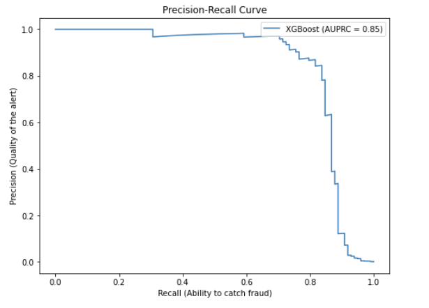

# 💳 Credit Card Fraud Detection System

<div align="center">


**End-to-end fraud detection pipeline on 284,807 real transactions.**  
AUPRC of 0.8454 catches 89% of fraud cases on a dataset where fraud is 0.17% of all transactions.

</div>

---

## ⚡ Results at a Glance

| Metric | Result |
|---|---|
| 📊 AUPRC (Primary Metric) | **0.8454** |
| 🎯 Fraud Recall | **0.89** — catches 89 of every 100 fraud cases |
| 🎯 Fraud Precision | 0.33 — accepted trade-off to maximize recall |
| 📁 Dataset | 284,807 transactions, 492 fraud cases (0.17% fraud rate) |
| ⚖️ SMOTE Resampling | 394 → 227,451 synthetic fraud cases in training set |
| 🤖 Model | XGBoost (`n_estimators=100`, `max_depth=6`, `lr=0.1`) |

---

## 🧠 Why AUPRC, Not Accuracy?

The model achieves **100% accuracy** on this dataset because predicting "not fraud" for every single transaction would be correct 99.83% of the time. Accuracy is a useless metric here.

**AUPRC (Area Under Precision-Recall Curve)** is the correct metric: it measures how well the model identifies fraud across all decision thresholds, with a focus on the minority class. An AUPRC of **0.8454** means the model has learned genuine fraud patterns, not just exploiting class imbalance.

---

## 🏗️ Pipeline Architecture

```
284,807 Transactions (0.17% fraud)
    │
    ▼
Preprocessing
├── StandardScaler on Amount feature
└── Drop Time column (low signal for this baseline)
    │
    ▼
Train/Test Split (80/20, stratified)   ← Split BEFORE SMOTE to prevent data leakage
    │
    ▼
SMOTE on training set only
├── Before: 394 fraud cases
└── After:  227,451 synthetic fraud cases
    │
    ▼
XGBoost Classifier
├── n_estimators=100, max_depth=6, learning_rate=0.1
└── scale_pos_weight=1  (SMOTE already handled imbalance)
    │
    ▼
Evaluation on original unbalanced test set
└── AUPRC: 0.8454 | Fraud Recall: 0.89
```

---

## 💻 Core Implementation

```python
# Split BEFORE SMOTE — applying SMOTE before splitting leaks synthetic data into the test set
X_train, X_test, y_train, y_test = train_test_split(
    X, y, test_size=0.2, random_state=42, stratify=y
)

# SMOTE on training set only
sm = SMOTE(random_state=42)
X_train_res, y_train_res = sm.fit_resample(X_train, y_train)
# 394 real fraud cases → 227,451 synthetic fraud cases

model = XGBClassifier(
    n_estimators=100,
    learning_rate=0.1,
    max_depth=6,
    scale_pos_weight=1,   # Set to 1 — SMOTE already balanced the classes
    eval_metric='logloss'
)
model.fit(X_train_res, y_train_res)
```

---

## 🛠️ Tech Stack

| Layer | Technology |
|---|---|
| Core Model | XGBoost (`XGBClassifier`) |
| Imbalance Handling | SMOTE (`imblearn.over_sampling`) |
| Preprocessing | `StandardScaler` on Amount; Time dropped |
| Evaluation | `average_precision_score`, `precision_recall_curve` |
| Visualization | Matplotlib (Precision-Recall curve) |
| Dataset | [Kaggle Credit Card Fraud Detection](https://www.kaggle.com/datasets/mlg-ulb/creditcardfraud) |

---

## 📊 Classification Report (Actual Output)

```
              precision    recall  f1-score   support

           0       1.00      1.00      1.00     56864   ← Legitimate
           1       0.33      0.89      0.48        98   ← Fraud

    accuracy                           1.00     56962
    AUPRC:  0.8454
```

**Reading the fraud row:** The model catches 89% of actual fraud cases (recall=0.89). The precision of 0.33 means roughly 1 in 3 flagged transactions is real fraud, the rest are false alarms. In a real deployment, a human review queue would triage flagged cases, making high recall the correct priority over precision.

---

## 📈 Precision-Recall Curve



---

## 🔑 Key Engineering Decisions

- **Why SMOTE before split? No split first.** SMOTE is applied to the training set *only*. Applying it before splitting would contaminate the test set with synthetic samples adjacent to real ones, inflating evaluation metrics artificially.
- **Why `scale_pos_weight=1`?** Since SMOTE already balanced the training classes to 50/50, using a positive weight multiplier would over-correct and bias toward fraud predictions.
- **Why drop `Time`?** Time is a sequential index in this dataset, not a meaningful temporal feature. Keeping it would introduce positional leakage into the model.
- **Why XGBoost over Random Forest?** XGBoost's gradient boosting iteratively corrects residuals it learns the hard-to-classify borderline fraud cases more effectively than bagging-based approaches on tabular financial data.
- **Why prioritize recall over precision?** Missing a fraud case costs the bank and customer far more than a false alarm that triggers a verification call. The threshold is set to maximize recall at acceptable precision.

---

## 🚀 Quick Start

```bash
# 1. Clone
git clone https://github.com/Rahilshah01/credit-card-fraud-detection.git
cd credit-card-fraud-detection

# 2. Install
pip install scikit-learn xgboost imbalanced-learn pandas matplotlib seaborn

# 3. Add dataset
# Download creditcard.csv from Kaggle → place in project root

# 4. Run notebook
jupyter notebook fraud_detection.ipynb
```

---

*Built by [Rahil Shah](https://rahil-shah-portfolio.vercel.app/) · MS Data Science @ Stevens Institute of Technology*
